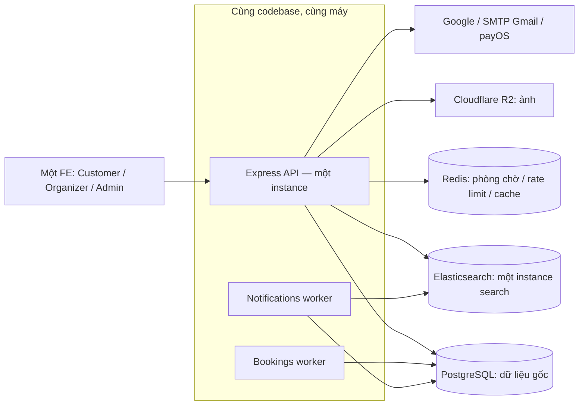

# 19. Kiến trúc và sơ đồ hệ thống

Cập nhật2026-10-15 theo ADR-025/028/029/036/037/038. Sơ đồ hiện hành dùng Mermaid trực tiếp trong tài liệu; bộ gallery/SVG lịch sử đã được xóa, không còn đường dẫn `Docs/diagrams/` để mở.

Hai worker là process cùng ứng dụng hiện có, không phải microservice. Redis/R2/search trong phạm vi đã duyệt; sơ đồ không cấp quyền thêm API instance, broker, cluster hoặc replication. PostgreSQL giữ nguồn sự thật inventory/idempotency/tiền/vé; cache và search không thay kiểm tra quyền hoặc khóa tồn kho.

| Nội dung | Nguồn hiện hành |
| --- | --- |
| Cấu trúc module và trách nhiệm file | [10 — Backend](10-backend-architecture.md), [31 — Cấu trúc code](31-backend-code-structure.md) |
| Auth, onboarding và quyền | [04 — Auth](04-authentication-authorization.md), [33 — Onboarding](33-registration-onboarding.md), [35 — Questionnaire](35-admin-onboarding-questions.md) |
| Schema và quan hệ vật lý | [schema.sql](../database/schema.sql), [08 — Database](08-database-design.md), [20 — SQL vật lý](20-physical-sql-design.md) |
| Hồ sơ/follow/attendee và gộp schema | [29](29-profile-follow-age-attendees.md), [30](30-schema-consolidation.md), [36](36-schema-audit.md) |
| Hold, tranh chấp và tiền đến muộn | [11 — Concurrency](11-booking-concurrency.md), [21 — Transaction](21-sql-transactions.md), [32 — Payment/vé](32-payos-booking-ticket-flow.md) |
| Refund, feedback và vận hành sự kiện | [37](37-refunds-reviews-app-feedback.md), [38 — ERD thay đổi/hủy](38-organizer-sales-operations.md) |
| Quan hệ ẩn Organizer và Admin gỡ event | [40 — ERD organization_blocks](40-backend-functional-completion.md) |
| Search/outbox và outdoor inventory | [41](41-home-event-search.md), [42 — ERD inventory](42-outdoor-zone-ticketing.md) |
| SKU/order/ledger/membership và mở bán | [44 — ERD v1](44-backend-v1-extensions.md) |
| Quản trị role/permission/UserRole/audit | [46 — RBAC018](46-dynamic-rbac.md) |
| Readiness, worker, HTTPS và restore | [39](39-backend-operational-readiness.md) |
| Phạm vi v1 và quyết định còn chờ | [43](43-backend-v1.md), [18](18-open-questions.md) |

ERD dùng tên bảng/cột snake_case và chỉ vẽ FK vật lý. `aggregate_type/id`, `resource_type/id` là tham chiếu đa hình do service quản lý; không vẽ thành FK DB. Mermaid chỉ hiển thị cột trọng yếu; schema.sql và migration giữ định nghĩa đầy đủ của51 bảng hiện hành.

Khi đổi model, cập nhật SQL, migration, ERD Mermaid và hợp đồng cùng nhau. Không dựng lại công cụ xuất SVG/gallery hoặc thêm dependency chỉ để xem sơ đồ. Sơ đồ thiết kế và kết quả kiểm chứng là hai loại bằng chứng riêng; xem log tại [26](26-auth-progress.md).
