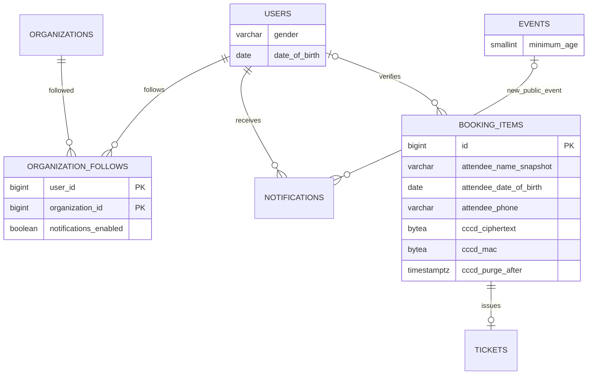

# 29. Hồ sơ, theo dõi, thông báo và tuổi người tham dự

Chủ dự án chốt ngày 2026-10-11, ADR-023/Q-024. Phạm vi bước này là BE; FE chưa được nối với các API mới.

## Hồ sơ riêng tư

User có `gender` nullable: MALE/FEMALE/OTHER/UNDISCLOSED và `dateOfBirth` nullable dạng YYYY-MM-DD. Không bắt khai khi login. GET/PATCH users/me chỉ cho chính User; PATCH cho phép displayName/gender/dateOfBirth, ít nhất một trường, có thể xóa gender/DOB bằng null. Ngày sinh phải là ngày thật, từ năm 0001, không ở tương lai so với CURRENT_DATE của connection UTC. Không lưu số tuổi cố định. Trả DOB dưới dạng chuỗi ngày, tránh dịch timezone; không đưa DOB/gender vào catalog, danh sách theo dõi, notification, auth token hoặc audit payload.

Đây là thông tin tự khai, không chứng minh danh tính hoặc cấp quyền. Google/EMAIL/company identity, JWT/refresh/cookie/CSRF giữ nguyên.

## Theo dõi và inbox

Customer theo dõi Organization APPROVED qua public organizer ID. Organizer/Admin muốn dùng hành động này cần role CUSTOMER riêng; theo dõi không cấp quyền quản lý.

| API dưới /api/v1 | Kết quả |
| --- | --- |
| GET /users/me/following?page=1&pageSize=20 | Danh sách theo dõi của mình, pagination |
| GET /organizers/:id/follow | following/notificationsEnabled |
| PUT /organizers/:id/follow | Theo dõi, JSON `{notificationsEnabled?}`; lần đầu mặc định true, lặp không truyền preference giữ tùy chọn cũ |
| PATCH /organizers/:id/follow | JSON `{notificationsEnabled}` bắt buộc, thay preference khi đang theo dõi |
| DELETE /organizers/:id/follow | Bỏ theo dõi idempotent; vẫn có thể bỏ khi tổ chức bị đình chỉ |
| GET /notifications?page=1&pageSize=20 | Inbox của mình, unreadCount và pagination |
| POST /notifications/:id/read | Đánh dấu đọc idempotent; ngoài scope 404 |

Mutation cần Origin ứng dụng + Bearer JWT. Inbox giữ hỗ trợ notification review cũ; mở rộng type FOLLOWED_ORGANIZER_EVENT với event_id. Notification sự kiện bị BLOCKED/CANCELLED hoặc tổ chức không APPROVED không hiện trong inbox/count. Không có email hoặc browser push trong phạm vi này.

Database tạo outbox khi event PUBLISHED và đã có publication; deferred trigger kiểm tra trạng thái cuối transaction. Không gửi khi DRAFT/PENDING_REVIEW, không trao quyền publish. Dedupe `followed-event:<event DB id>` chỉ thông báo lần công khai đầu; publication hẹn giờ có available_at đúng thời điểm công khai. Migration không tạo thông báo cho catalog cũ.

Worker kiểm tra lại sự kiện công khai, tổ chức và User ACTIVE/CUSTOMER, follow và preference còn bật. created_at/notifications_enabled_at phải không sau thời điểm công khai, nên follow hoặc bật lại sau đó không nhận thông báo cũ. Fan-out tối đa 500 recipient/transaction, cursor User ID trong outbox; INSERT notification và cập nhật cursor/DONE nguyên tử, FOR UPDATE SKIP LOCKED và unique recipient/type/event chống gửi trùng. Đây là xử lý thuần DB, không gọi provider qua mạng hoặc cần lease PROCESSING; không áp dụng cách này cho email/payment worker có network.

## Tuổi tối thiểu của sự kiện

`events.minimum_age SMALLINT NULL`; null là không giới hạn, giá trị 1–32767 theo miền kiểu dữ liệu. `ageTag` trong response được tính từ minimum_age, ví dụ 16+ hoặc 18+, không nhận tag tự do độc lập. Catalog trả minimumAge/ageTag nhưng FE chưa hiển thị nhãn mới.

PATCH /events/:id/age-restriction (ID DB) nhận `{minimumAge,version}`. Chỉ event DRAFT, đúng version, permission event.update_own, company session/membership/Organization/ownership. Tăng version và audit trong transaction; không sửa PUBLISHED để vượt review.

POST /events/:publicId/sessions/:sessionId/age-eligibility nhận `{dateOfBirth?}`. Không truyền DOB thì dùng hồ sơ chính User; thiếu DOB trả 422. Trả minimumAge/ageTag, ageAtSession, referenceDate, eligible và identityVerified=false. referenceDate lấy ngày starts_at tại timezone của venue; ngày sinh chưa tới trong năm thì trừ một tuổi. Sinh 29/02 chỉ đủ tuổi vào 01/03 trong năm không nhuận theo phép tính năm tròn hiện hành; không suy tuổi từ CCCD. Kiểm tra này là dự tính từ dữ liệu tự khai, không xác minh giấy tờ hay đặt vé.

## Một bộ thông tin riêng cho mỗi vé

Chủ dự án chọn: mỗi vé có họ tên, ngày sinh, SĐT và số CCCD 12 chữ số; đối chiếu CCCD thật tại cửa, chưa xác minh online. Không upload ảnh giấy tờ. SĐT người tham dự là dữ liệu liên hệ tự khai, không trở thành alias hoặc proof auth.

GET/PUT /bookings/:id/attendees chỉ người mua của booking. PUT nhận `{attendees:[{bookingItemId,fullName,dateOfBirth,phone,cccd}]}` với đúng toàn bộ bookingItemIds, mỗi item một entry, tối đa 6 theo BR hiện có. Ba vé cần ba bộ thông tin; không lấy DOB của người mua thay mọi người. Không tự đặt quy tắc một CCCD chỉ được mua một vé. Kiểm tra tuổi từng người theo suất, ngày sinh thật/không tương lai, chuẩn hóa SĐT E.164. Thiếu người hoặc một người chưa đủ tuổi làm rollback cả batch.

Chỉ sửa khi booking AWAITING_PAYMENT chưa hết hạn, event PUBLISHED/session SCHEDULED. Khóa quota → event → session → booking → items theo thứ tự; ghi tên snapshot và audit cùng transaction. CONFIRMED không sửa attendee. Dữ liệu nằm trực tiếp trong booking_items (ADR-024), dùng lại attendee_name_snapshot để có trước thanh toán; mỗi Ticket dùng đúng dữ liệu qua booking_item_id. Trigger DB từ chối chuyển booking sang CONFIRMED khi thiếu dữ liệu hoặc có người chưa đủ tuổi.

CCCD dùng AES-256-GCM, nonce ngẫu nhiên, AAD bookingItem/session; HMAC khóa riêng cho so khớp theo session và chỉ lưu last four để che số. ATTENDEE_PII_KEY là master key 32 byte độc lập ngoài Git, HKDF tách purpose mã hóa/so khớp; không dùng JWT/OTP/R2 secret. Không trả ciphertext/MAC hoặc số đầy đủ; GET chỉ maskedCccd, dữ liệu cá nhân scope chủ booking. Không log CCCD, DOB hoặc request body vào audit; chỉ action/resource/actor/request ID. Key version attendee-v1; đổi khóa khi còn dữ liệu cần kế hoạch rotation/migration riêng.

POST /tickets/:id/attendee-verification nhận `{cccd,fullName,dateOfBirth,physicalDocumentSeen:true}`. Staff phải có ticket.checkin_own, company identity đã duyệt, membership ACTIVE/Organization APPROVED và đúng event của tổ chức. Chỉ vé VALID, booking CONFIRMED, event PUBLISHED/session SCHEDULED, trong cửa sổ admission. So CCCD bằng keyed MAC, họ tên/DOB khớp chính xác và đủ tuổi; ghi actor/time đã đối chiếu giấy tờ. Customer không tự xác minh. Endpoint này không consume vé, tạo CheckIn, chuyển USED hoặc thay quy trình admission; trigger USED yêu cầu đã xác minh và đủ tuổi.

CCCD đầy đủ, MAC, last four và key version được xóa sau ends_at của suất + 30 ngày; worker purge theo batch 1000. Giữ thông tin vé/giao dịch và lịch sử đã xác minh, không xóa booking/ticket. API không hiện last four hoặc cho verify sau deadline dù worker tạm ngừng. Xóa vật lý cần worker chạy; chính sách backup/khôi phục vận hành cần tính cùng thời hạn lưu, không dùng backup để tái phục vụ CCCD đã hết hạn.

## Vận hành và trạng thái thực tế

Sau rà soát theo yêu cầu chủ dự án, schema hiện hành có 46 bảng: migration 006 gộp dữ liệu attendee vào booking_items và bỏ events.age_tag (tính trong query). Migration 004/005 bên dưới là lịch sử đã áp dụng; không sửa/chạy lại chúng. Xem [ADR-024/rà soát](30-schema-consolidation.md).

Migration 004/005 đã kiểm thử schema mới 47 bảng và upgrade 45 → 47 bảng. Đã backup DB local bằng pg_dump custom, kiểm tra pg_restore --list và áp dụng cả hai trong một transaction; không có vé VALID/USED cũ cần chuyển đổi. Backup giữ ở backups/ (Git ignore). Đã tạo ATTENDEE_PII_KEY riêng trong BE/.env, không hiển thị/commit giá trị; setup:env cũng sinh key khi tạo env mới.

Khởi động lại BE để nhận cấu hình/schema mới. Chạy API và worker ở hai terminal trong BE:

```powershell
. .\scripts\use-node.ps1
npm.cmd run dev
```

```powershell
. .\scripts\use-node.ps1
npm.cmd run worker:notifications
```

Worker xử lý notification và purge CCCD, poll 3 giây, giữ outbox PENDING khi lỗi. API một mình không chạy worker. Chưa có email/push, FE follow/inbox/tuổi/attendee, company login live, tạo booking/hold, thanh toán, phát vé hoặc admission đầy đủ. API quản lý tuổi và xác minh staff được kiểm thử bằng company session trong DB fixture; không ghi đã có luồng company login thật. Trigger chuẩn bị tích hợp các flow về sau và không tự cấp quyền/quyết định thanh toán.

64 kiểm tra HTTP/PostgreSQL qua: DOB/gender/sparse update, birthday/leap date, permission/version/event tag, follow/mute/unfollow, publication/outbox/dedupe/inbox/IDOR, follower đến sau, fan-out 500+1, ba bộ attendee, tuổi từng người/rollback, CCCD che số/mã hóa, staff đúng scope, confirmation/USED guard và retention. Hai DB riêng đã drop; script kiểm thử được dọn theo PROJECT_RULES, không khôi phục bộ auth tests đã bị xóa trước đó. Chưa coi đây là E2E mua vé/payment live.

ESLint, TypeScript, cấu hình build noEmit, format source/config/module README, secret guard và git diff --check đã qua. Không khởi chạy server hoặc worker nền để lại sau bước kiểm thử; cần chạy worker theo hướng dẫn để notification/purge được xử lý thường xuyên.

## Các quan hệ bổ sung


