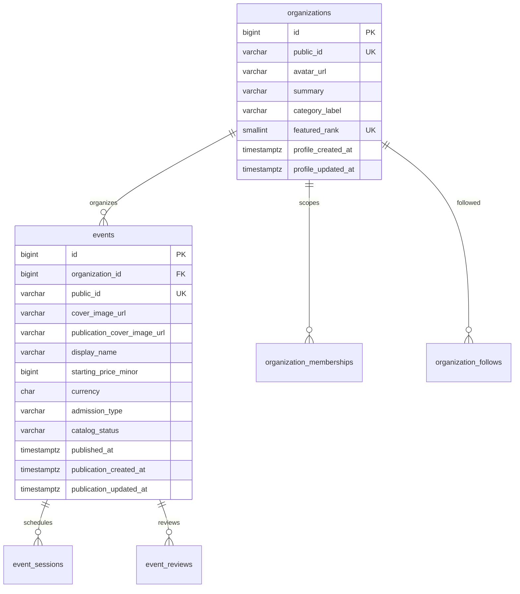

# 36. Rà soát số lượng bảng và khả năng gộp — 2026-10-12

## Kết quả thực tế

Audit ban đầu chỉ đọc metadata/FK/count. Sau đó chủ dự án yêu cầu gộp và áp dụng trực tiếp DB. Migration011 đã thực hiện, cùng các migration008/009/010 còn thiếu, trong một transaction. DB local và fresh hiện đều **45 bảng**.

- Trước nâng cấp, DB local có **46 bảng**, không có bảng nằm ngoài danh sách schema hiện hành.
- Trước gộp, source fresh có **47 bảng**, thêm onboarding_questionnaires từ migration010 chưa áp dụng. Migration008/009 không thêm bảng.
- Không có CREATE TABLE trùng tên trong schema.sql; không có hai bảng có danh sách cột hoàn toàn giống nhau. Đây là kiểm tra cấu trúc, không tự chứng minh mọi bảng đều cần tách.
- ticket_attendees đã bỏ từ migration006; DOB/SĐT/CCCD attendee dùng booking_items. CREATE trong migration005 là lịch sử nâng cấp, không phải một bảng tồn tại thêm bên cạnh schema hiện hành.
- 44/46 bảng local có tham chiếu trong repository. Hai bảng chưa có repository nghiệp vụ là refunds và support_reports, đều0 hàng. Đó là chức năng chưa triển khai, chưa đủ lý do xóa vì đặc tả và FK/query mẫu vẫn dùng.
- Tổng bảng/index khoảng **3 MiB** tại thời điểm kiểm tra (pg_size_pretty3096kB), chưa có vấn đề dung lượng được chứng minh. Số lượng bảng chủ yếu là độ phức tạp mô hình, không phải bằng chứng cần mở rộng hạ tầng.

## Các bảng có thể gộp để đơn giản hơn

| Bảng đang tách | Quan hệ và dữ liệu | Đánh giá |
| --- | --- | --- |
| organization_profiles → organizations | PK organization_id, 0..1 profile/tổ chức; local12 profiles/12 tổ chức | **Đã gộp bằng011.** Avatar/summary/public ID/category/featured có thể trở thành các field nullable của Organization, có CHECK trước công khai. Giữ DTO công khai riêng để không lộ identity/review metadata. Không cần một bảng chỉ để tách response private/public. |
| event_publications → events | PK event_id, 0..1 bản publication/event; local13/13 | **Đã gộp bằng011.** Lưu nhóm field publication trên Event và giữ trạng thái/approval/check riêng. Cần giữ public IDs, lịch công bố, giá hiển thị và deferred notification hook. Một bản publication duy nhất không phải bảng lịch sử nhiều phiên bản. |
| reason_notices → event_reviews | UNIQUE review_id, 0..1 notice/review; local0 notices/13 reviews | **Có thể thiết kế gộp nhưng ít ưu tiên.** Review có deadline/decision, notice còn DRAFT sau khi review EXPIRED rồi SENT bất biến. Gộp vẫn phải giữ hai trạng thái, người soạn, version, FK/ID và thông báo. Không được bỏ luồng lý do để giảm số bảng. |
| reservation_quotas | Chỉ customer_id/session_id/created_at,0 hàng local | Không lưu bộ đếm quota; là hàng khóa chung cho lượt hold/booking/expiry/attendee. Có thể thay bằng cơ chế khóa khác sau kiểm thử tranh chấp, nhưng **không phải bảng dữ liệu trùng có thể DROP độc lập**. Khóa User sẵn có không thay toàn bộ đường worker/callback hiện tại. |

Đã gộp hai bảng đầu và DROP bảng cũ sau khi copy/EXCEPT kiểm tra mọi field. Không tạo compatibility view. Profile timestamps giữ trên organizations; publication timestamps/ảnh công bố giữ trên events. Các cột snapshot và ảnh nháp có ý nghĩa riêng, không xóa khi giá trị khác nhau.

Lý do phải copy trước khi DROP: hai bảng cũ có dữ liệu và được dùng trong catalog, follow, recommendations, booking/ticket và seed. Publication còn có deferred trigger tạo notification. Trước gộp,13 ảnh công khai chỉ nằm tại event_publications, events.cover_image_url là NULL; xóa cột/bảng publication mà không copy sẽ làm mất ảnh. Hiện ảnh nằm tại events.publication_cover_image_url.

Đã sửa catalog/follow/recommendations/booking/ticket, seed, readiness và deferred notification hook sang bảng cha. Giữ DTO công khai với SELECT field tường minh. Migration không dùng DROP CASCADE và không enqueue lại sự kiện cũ trong lúc copy. schema.sql chỉ chạy trên DB rỗng; DDL chứa các bước chuyển tiếp rồi bỏ hai bảng extension trước COMMIT, kết quả45 bảng.

## Vì sao phần còn lại nhiều bảng

| Nhóm | Số bảng fresh | Tên bảng và mục đích |
| --- | --- | --- |
| Tài khoản, quyền, xác minh và phiên | 10 | users; roles/permissions/user_roles/role_permissions là dictionary và ánh xạ; external_identities, phone_login_aliases, otp_challenges, auth_sessions, refresh_tokens là identity, alias, proof, session và lịch sử rotation |
| Tổ chức và theo dõi | 3 | organizations chứa metadata công khai; organization_memberships và organization_follows là hai quan hệ nhiều tài khoản |
| Sự kiện và catalog | 8 | events chứa metadata công bố; event_categories, event_sessions, event_change_requests, venues, city_profiles, merchandise_products, blog_articles |
| Sơ đồ và inventory | 6 | seat_layouts, layout_sections, layout_rows, seats, ticket_types, session_seats; vị trí vật lý khác tồn kho/giá/trạng thái của từng suất |
| Giữ chỗ, đơn và vé | 7 | reservation_quotas, seat_holds, seat_hold_items, bookings, booking_items, tickets, check_ins; giữ tạm/đơn đã mua/vé/check-in có trạng thái và thời hạn khác nhau |
| Tiền và chống xử lý lặp | 4 | payments, payment_webhooks, refunds, idempotency_records; một giao dịch có nhiều receipt/callback, hoàn tiền và retry API khác nhau |
| Duyệt, thông báo và vận hành | 6 | event_reviews, reason_notices, notifications, support_reports, audit_logs, outbox_messages; review snapshot/history, notice draft/sent, inbox/read state, report, audit và công việc retry |
| Bộ câu hỏi có phiên bản | 1 | onboarding_questionnaires; nhiều User tham chiếu một bộ câu hỏi, giữ lịch sử khi Admin sửa/bỏ câu. Custom answers đã gộp vào Users, không có bảng answers1:1 |
| **Tổng** | **45** | DB local đã áp dụng008–011, cùng số bảng fresh |

Một số bảng giống tên nhưng khác vòng đời:

- auth_sessions có6 hàng, refresh_tokens có30 hàng: token rotation là1:N, không thể giữ một refresh token duy nhất mà vẫn giữ kiểm tra reuse/family theo hợp đồng hiện tại.
- seat_hold_items là tập ghế/giá lúc giữ; booking_items là dữ liệu đơn/attendee; tickets là credential sau xác nhận tiền. Không bỏ snapshot vì hiện các bảng này0 hàng local.
- event_reviews duyệt bản nháp, event_change_requests yêu cầu sửa/mở bán lại sau công khai. Bảng thứ hai mới có đọc catalog và chưa có toàn bộ workflow mutation, nhưng không phải review trùng.
- notifications là inbox có read_at; outbox_messages là việc phải thực hiện/retry; payment_webhooks là receipt/dedupe provider. Một receipt có thể dẫn tới công việc hoặc notification, không phải ba bản cùng dữ liệu.
- Users DOB/SĐT đăng nhập không thay thông tin từng người tham dự. Một Customer có thể mua ba vé cho ba người.

## Kết luận hành động

Đã giảm hai bảng extension1:1, giữ những bảng còn lại có vòng đời/quan hệ riêng. Local46 + questionnaire1 − hai bảng extension2 =45.

Backup trước008–011: backups/before-008-011-1791740552152.dump, đã xác minh pg_restore --list. Local giữ12 hồ sơ tổ chức,13 publication/ảnh. Kiểm tra hash và số hàng xác nhận phiên/identity/token/OTP, role assignment, đơn/tiền/vé, audit/outbox không đổi. Không cấp Admin thật.

Kiểm chứng: fresh và populated upgrade007–011 khớp metadata; ảnh nháp khác ảnh công bố/timestamp được giữ; không enqueue lại outbox. BE86 kiểm thử qua, PG/Edge25/25 qua (onboarding → ba vé → payment giả → check-in/admission). db:check DB thật qua. HTTP readiness/home/events/organizers/detail200 trên DB thật,13 events/12 organizers và ảnh giữ nguyên. Chưa thử chuyển tiền thật.

## ERD phần đã gộp

Sơ đồ chỉ thể hiện phần gộp và các quan hệ liên quan, không thay toàn bộ ERD45 bảng. Không tạo entity mới cho metadata công khai.

## Bổ sung sau đợt gộp — ADR-032

Kết quả45 bảng của ADR-031 ở trên là mốc sau gộp. Sau yêu cầu refund/review/app feedback, migration012 dùng lại refunds/support_reports và chỉ thêm một bảng feedback cho hai target. Local/fresh hiện46 bảng. event_reviews vẫn là hồ sơ duyệt, không thay Customer review. Lý do dữ liệu/ERD/API tại [37](37-refunds-reviews-app-feedback.md). Không phục hồi hai extension catalog đã bỏ.
