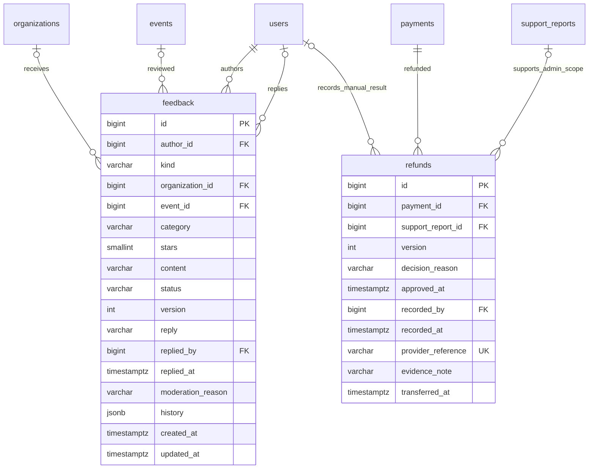

# 37. Hoàn tiền, đánh giá tổ chức và góp ý hệ thống

Chủ dự án chốt2026-10-12 / ADR-032. BE đã triển khai và kiểm thử; FE cho ba chức năng này chưa nối. Modular Monolith một API, không thêm broker/hạ tầng. Không cấp Admin thật hoặc chuyển tiền thật để kiểm thử.

## Hoàn tiền thủ công

- Customer yêu cầu hoàn **toàn bộ đơn**, mọi vé còn VALID/chưa USED, payment SUCCESS đúng số tiền và không cần đối soát. Yêu cầu phải tới BE trước suất ít nhất24 giờ, bằng đúng mốc vẫn hợp lệ. Không tính hạn theo ngày gửi duyệt sự kiện.
- Organizer có refund.approve và membership ACTIVE trong tổ chức APPROVED duyệt bình thường. Admin phải có report IN_REVIEW được giao cho mình, liên kết đúng booking/event; không cấp quyền qua một reportId tùy ý.
- REQUESTED → REJECTED hoặc PROCESSING. Khi duyệt PROCESSING, mọi vé chuyển CANCELLED trong cùng transaction. Quota → Organization/report → Event/session → Hold/Booking → ghế → Payment/Refund → Ticket theo giao thức khóa. Tranh chấp admission/refund chỉ một bên được quyền thực hiện; check-in giữ lịch sử.
- PROCESSING → FAILED hoặc SUCCESS. FAILED → PROCESSING khi người vận hành retry; giữ refund/provider key. Không hồi sinh vé hoặc bán lại ghế. REJECTED giữ vé và cho gửi yêu cầu mới nếu còn đủ điều kiện.
- SUCCESS yêu cầu reference/mã chứng từ, evidenceNote mô tả chứng từ, transferredAt sau lúc duyệt và không ở tương lai, recorded_by/at. Ghi nhận thủ công từ người vận hành, **không phải xác nhận chuyển tiền của payOS**. Chưa hỗ trợ upload ảnh chứng từ hoặc tự kiểm tra giao dịch ngân hàng.
- Khi ghi nhận SUCCESS, Payment/Booking/Ticket → REFUNDED nguyên tử. SessionSeat giữ SOLD vì chính sách không resale. Lỗi/chứng từ trùng rollback toàn bộ. Một reference không thể hoàn hai refund, kể cả ghi nhận đồng thời.
- Callback lặp sau refund không cộng tiền lại. Khoản mới đến sau refund giữ REFUNDED và đối soát REQUIRED/FUNDS_AFTER_REFUND; không phát lại vé hoặc xác nhận lại đơn.
- Tiền thiếu/dư/muộn, compensation khi hủy sự kiện hoặc vé USED không tự áp dụng policy hoàn tự nguyện này; cần đối soát/chính sách riêng theo Q-004/Q-019.

## Đánh giá tổ chức

Customer có đơn CONFIRMED/REFUNDED đã phát vé cho suất kết thúc hoặc sự kiện/suất bị hủy được gửi1–5 sao và nội dung. Một đánh giá/người/sự kiện, không nhân trọng số vì mua nhiều vé. Không cho thành viên đánh giá tổ chức mình. Không bắt người mua sự kiện bị hủy phải check-in.

Người gửi được sửa sao/nội dung trong7 ngày kể từ lúc gửi, thời gian DB; không gia hạn bằng sửa. Giữ history trên cùng feedback row, version chống ghi đè. Organizer được trả lời, không xóa/ẩn; Admin ẩn/hiện có lý do, giữ lịch sử. Sửa đánh giá đang HIDDEN không tự hiện lại.

Theo câu trả lời mới nhất, đánh giá chỉ cho **người gửi, Organizer đúng tổ chức và Admin** xem; chưa công khai nội dung hoặc sao trên catalog. VISIBLE chỉ nghĩa là được tính vào sao tổng hợp nội bộ. Góp ý hệ thống không được tính vào sao tổ chức. Chưa triển khai thuật toán uy tín tự động hoặc tự approve/khóa tổ chức theo sao.

## Góp ý app

Mọi tài khoản có phiên hợp lệ được gửi loại BUG/PERFORMANCE/USABILITY/OTHER, nội dung và sao1–5 tùy chọn. Chỉ người gửi và Admin feedback.manage xem. Organizer không có quyền đọc góp ý app của người khác, kể cả khi nội dung nhắc tên tổ chức. Admin trả lời và cập nhật OPEN/IN_REVIEW/RESOLVED. Người gửi đọc được kết quả xử lý của mình.

Không có API công khai cho feedback, không public booking ID/mã vé/DOB/SĐT/CCCD. Response không trả history và nội dung không đưa vào audit; audit chỉ lưu actor/action/resource/request metadata.

## API/Swagger

Prefix `/api/v1`; JWT, Origin đúng PUBLIC_APP_URL và Idempotency-Key cho mutation; body JSON và version mới nhất. Retry cùng key/body, không đổi payload trên một key. ID DB/tiền là chuỗi, ngày giờ ISO8601 có offset. Pagination page/pageSize giới hạn100.

| API | Công dụng |
| --- | --- |
| POST `/bookings/{bookingId}/refunds` | Customer yêu cầu, body reason |
| GET `/users/me/refunds`, `/{id}` | Customer xem yêu cầu/kết quả của mình |
| GET `/organizer/organizations/{organizationId}/refunds` | Danh sách đúng tổ chức |
| GET `/organizer/refunds/{id}` | Chi tiết đúng tổ chức |
| POST `/organizer/refunds/{id}/approve`, `/reject`, `/retry` | version/reason |
| POST `/organizer/refunds/{id}/result` | Ghi SUCCESS/FAILED thủ công |
| GET `/admin/refunds`, `/{id}` | Bắt buộc query reportId đang được giao đúng booking |
| POST `/admin/refunds/{id}/approve`, `/reject`, `/retry`, `/result` | Cùng body như Organizer, bắt buộc reportId |
| POST `/bookings/{bookingId}/support-reports` | Customer gửi report của đơn mình, body reason |
| GET `/users/me/support-reports`, `/admin/support-reports` | Danh sách theo quyền |
| POST `/admin/support-reports/{id}/claim` | Admin nhận report OPEN, body {} |
| POST `/admin/support-reports/{id}/resolve` | version/resolution; đóng report thu hồi scope refund |
| POST `/feedback` | Gửi ORGANIZATION hoặc SYSTEM |
| GET `/users/me/feedback`, `/{id}` | Người gửi xem riêng tư |
| PATCH `/users/me/feedback/{id}` | Sửa đánh giá tổ chức trong7 ngày, version/stars/content |
| GET `/organizer/organizations/{organizationId}/feedback` | Đánh giá và count/average VISIBLE đúng tổ chức |
| GET `/organizer/feedback/{id}`; POST `/{id}/reply` | Organizer xem/trả lời, version/reply |
| GET `/admin/feedback?kind=SYSTEM`, `/{id}` | Admin xem phản hồi, kind optional |
| POST `/admin/feedback/{id}/handle` | Góp ý app: version/reply/status |
| POST `/admin/feedback/{id}/moderate` | Đánh giá tổ chức: version/hidden/reason |

Body gửi đánh giá tổ chức:

```json
{"kind":"ORGANIZATION","eventId":"123","stars":4,"content":"Nội dung đánh giá"}
```

eventId số lấy từ GET booking của mình (đã thêm eventId), khác public ID catalog. Không tự gửi organizationId/authorId/status.

Body góp ý app:

```json
{"kind":"SYSTEM","category":"PERFORMANCE","content":"Trang chọn ghế tải chậm","stars":2}
```

Body ghi kết quả hoàn tiền thành công (giá trị mẫu, không phải giao dịch thật):

```json
{"version":1,"status":"SUCCESS","reference":"bank-receipt-example","evidenceNote":"Mã chứng từ chuyển khoản được người vận hành đối chiếu","transferredAt":"2026-10-12T10:00:00+07:00"}
```

Thời điểm mẫu phải thay bằng thời điểm thực sau lúc duyệt; Admin thêm reportId đúng scope. FAILED dùng version/status FAILED/reason, không được giả SUCCESS khi chưa chuyển tiền.

## Schema và triển khai

Đã đối chiếu DB trước sửa: refunds/support_reports đều tồn tại,0 hàng; event_reviews là hồ sơ duyệt, không có bảng feedback/rating. Dùng lại refunds/reports. Migration012 thêm version/decision/evidence/recording fields vào refunds và một bảng feedback cho hai target với CHECK/FK/unique. History nằm trên feedback, không tạo bảng answers/review1:1. Profile/PII/Booking không sao chép.

RefundService phụ thuộc RefundBookingPort/RefundPaymentPort; BookingRefundAdapter/PaymentRefundAdapter giữ mutation trong module sở hữu, repository dùng cùng transaction connection. Không đặt SQL trong controller/service, không gọi provider trong transaction và không thêm cơ chế auth/provider mới.

Fresh schema và upgrade007–012 có dữ liệu seed khớp metadata. Local đã backup before-012-1791805498317.dump,241990 bytes, pg_restore --list hợp lệ rồi apply012 nguyên tử. DB hiện46 bảng; dữ liệu User/roles/credential/order/payment/ticket/audit/outbox giữ nguyên. Không chạy lại012 khi đã có schema; DB rỗng dùng schema.sql + seed. Upgrade có SUCCESS refund cũ thiếu bằng chứng phải kiểm tra/backfill có nguồn trước; không bịa chứng từ để vượt CHECK.

Kiểm chứng: BE86 unit/HTTP/architecture/config qua; PG/Edge34/34 qua, gồm deadline, full refund/reject/retry, USED, tranh chấp admission, chứng từ trùng, receipt sau refund, Admin report scope/đóng report, review đủ điều kiện và sự kiện hủy,7 ngày/history/moderation, privacy feedback và HTTP input/Origin/quyền, regression checkout nhiều ghế có ID qua biên chữ số. Provider/payment/receipt và chứng từ trong test là fixture trên DB tạm. Chưa kiểm thử chuyển/hoàn tiền thật hoặc FE ba chức năng mới.

## ERD phần bổ sung



Sơ đồ chỉ mô tả entity mới và các field refund thay đổi; FK event/org của feedback là composite, provider/reference của refund unique theo provider. SYSTEM có event/org NULL; ORGANIZATION bắt buộc cả hai và sao. Những field/quan hệ refund cũ vẫn giữ trong schema.sql.
