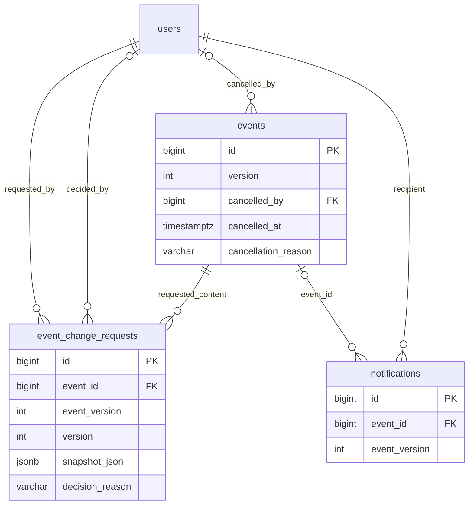

# 38. Bán vé, doanh thu và sửa/hủy sự kiện cho Organizer

Quyết định chủ dự án 2026-10-12: Modular Monolith một API; dùng lại worker bookings, outbox và các bảng hiện có. Chính sách thanh toán SUCCESS/FAILED và retry giữ hạn gốc theo ADR-033; không workflow tiền thiếu/dư, payout hoặc chuyển tiền tự động.

## Phần đã triển khai

| Chức năng | API `/api/v1` | Quyền và hành vi |
| --- | --- | --- |
| Đơn và chi tiết | GET `/organizer/organizations/{organizationId}/orders`, `/organizer/orders/{id}` | `sales.read_own`, Organization APPROVED, membership ACTIVE, onboarding và identity hợp lệ |
| Vé bán | GET `/organizer/organizations/{organizationId}/tickets` | Theo tổ chức; không trả QR/CCCD/ngày sinh/SĐT/checkout URL |
| Doanh thu | GET `/organizer/organizations/{organizationId}/sales-summary` | Tiền chuỗi, nhóm currency; không nhân doanh thu theo item/attempt |
| Dấu vết giao dịch | GET `/organizer/organizations/{organizationId}/reconciliation` | Chỉ đọc nội bộ, mặc định REQUIRED; không xử lý thiếu/dư hoặc tự phát lại vé |
| Sửa nội dung | GET/POST `/organizer/events/{id}/content-changes` | Chỉ title/description; version sự kiện, reason bắt buộc; một CONTENT PENDING/sự kiện |
| Rút yêu cầu | POST `/organizer/event-changes/{changeId}/withdraw` | Cùng tổ chức, version của yêu cầu; không thay bản đang công bố |
| Duyệt nội dung | GET `/admin/event-changes`; POST `/{changeId}/approve`, `/{changeId}/reject` | `event.review`, reason và version của yêu cầu; approve cần Organization APPROVED và event version khớp snapshot |
| Hủy | POST `/organizer/events/{id}/cancel` | `event.cancel_own`, event version/reason; mọi suất chưa bắt đầu và không vé USED |
| Theo dõi hậu xử lý | GET `/organizer/events/{id}/operations` | Trạng thái event và jobs PENDING/DONE/error; không credential hoặc payload worker |

Mutation cần Bearer, Origin website đã cấu hình và Idempotency-Key. Gửi lại request giữ cùng key/body; hành động mới dùng key mới. Không thay token, cookie, CSRF, đăng nhập hay cấp quyền từ FE. Admin vẫn chỉ dùng fixture cho kiểm thử; không cấp thêm tài khoản Admin thật.

Các list đơn/vé/giao dịch có eventId/sessionId/status/from/to/page/pageSize. `[from,to)` dựa **thời điểm tạo booking**, kể cả list vé/giao dịch; đây là thống kê nhóm đơn, không sổ thu tiền theo ngày chuyển khoản. `sales-summary` không nhận status/page. pageSize tối đa100.

`grossTicketSalesMinor` cộng tổng đơn CONFIRMED/REFUNDED một lần. `receivedMinor` cộng khoản đã nhận của mọi attempt. `refundedMinor` chỉ refund SUCCESS; `netReceivedMinor = receivedMinor - refundedMinor`. REQUESTED/PROCESSING/FAILED tách riêng và chưa trừ như đã hoàn. `reconciliationReceivedMinor` là phần nằm trong receivedMinor, không cộng lại. Báo cáo theo tổ chức không đồng nghĩa đã chi trả cho Organizer.

## Sửa và hủy sau mở bán

Yêu cầu CONTENT lưu snapshot bất biến tên/mô tả và event_version. Sự kiện vẫn bán theo bản cũ trong lúc chờ. Admin approve cập nhật title/display_name/description/version và enqueue thông báo; giữ lịch, sơ đồ, giới hạn tuổi, loại vé, giá, ghế, snapshot booking và vé. Yêu cầu cũ không áp dụng khi version đã đổi hoặc event đã hủy; reject/withdraw không sửa bản công bố.

Hủy khóa Event UPDATE rồi kiểm tra lại giờ DB và vé USED. Commit status CANCELLED cùng metadata người/lý do/thời gian, rút CONTENT đang chờ và enqueue một job theo event/version. Cờ này **chặn ngay** hold, payment confirmation và admission. Không lấy quota/ghế trong transaction hủy này.

`worker:bookings` xử lý từng hold/đơn trong transaction riêng: job → FK Users KEY SHARE theo ID → quota → Organization/Event/Session SHARE → hold/booking/ghế → payment/refund/ticket. Hold ACTIVE thành RELEASED; đơn chờ thành CANCELLED, nhả đúng ghế HELD thuộc nó, attempt PENDING chưa nhận tiền thành FAILED. Đơn đã trả giữ CONFIRMED trong lúc hoàn, vé VALID thành CANCELLED, ghế SOLD không bán lại.

Đơn đã trả được tạo refund **toàn bộ giá đơn** COMPENSATION/PROCESSING, hoặc duyệt yêu cầu CUSTOMER đang REQUESTED có sẵn. Dùng unique full_refund_guard để tránh tạo lại; refund PROCESSING/FAILED giữ quy trình thủ công hiện có. Đây là hoàn do hủy sự kiện đã được chốt, không workflow dư/thiếu. Organizer ghi SUCCESS bằng API refund result có reference/evidenceNote/transferredAt; khi hợp lệ booking/payment/ticket thành REFUNDED. Không tự gọi ngân hàng/payOS refund hoặc bịa chứng từ.

Cursor worker chỉ tiến cùng commit của cleanup/refund/notification; lỗi rollback và retry sau15 giây. Mỗi người/event/version nhận một thông báo, dù mua nhiều đơn. Sửa nội dung thông báo người đã trả tiền trước thời điểm duyệt; hủy thông báo người có hold/đơn. Inbox vẫn hiển thị EVENT_CANCELLED khi sự kiện không còn công khai. Trạng thái từng vé/đơn và hoàn tiền chuyển dần khi worker chạy; cổng bán/vào cửa đã đóng ngay từ commit hủy.

## Demo local và Swagger

Migration013 đã áp dụng DB local sau backup `backups/before-013-1791811206992.dump` (250227 bytes, pg_restore --list hợp lệ). Vẫn46 bảng; không thay lịch sử auth/role/tiền/vé. Không chạy lại013. DB rỗng dùng schema.sql; DB khác backup/review rồi dùng migration013, không chạy schema.sql lên dữ liệu hiện có.

Seed [003-local-ticket-sales.sql](../database/seeds/003-local-ticket-sales.sql) tạo một sự kiện `[DEMO LOCAL]`, public ID `local-ticket-sales-demo`, event970001, session970003,12 ghế/2.000 VND, minimumAge18. Đã nạp DB local. Hồ sơ APPROVED là **fixture local**, không chứng minh Admin vận hành đã duyệt; không tạo session đăng nhập, grant role hoặc payment. Chạy lặp không reset lịch, trạng thái ghế, đơn hoặc tiền. Không dùng seed trên production.

1. Chạy BE `npm.cmd run dev`; worker `npm.cmd run worker:bookings`. Redis hiện có cần hoạt động để vào phòng chờ/giữ ghế; worker không tự chạy cùng npm dev.
2. Đăng nhập Google/email OTP theo luồng bình thường, hoàn tất onboarding CUSTOMER. Swagger qua Origin FE cấu hình; không có endpoint hoặc token bypass cho fixture.
3. GET `/events/local-ticket-sales-demo/sessions`, rồi `/events/local-ticket-sales-demo/sessions/970003/seats` lấy ID ghế thật.
4. POST phòng chờ với body `{}`, GET lại khi cần theo poll interval trả về; hold ghế bằng Idempotency-Key, checkout không gia hạn5 phút.
5. PUT attendees: đúng một bộ họ tên/DOB/SĐT/CCCD mỗi booking item, đủ18 tuổi ở ngày suất. Có thể kiểm thử validate rồi hủy đơn chưa thanh toán. **Lượt bàn giao chưa chuyển tiền thật.**
6. Luồng payOS xác nhận → vé → check-in/admission và Organizer/Admin chạy bằng fixture trong `npm.cmd run test:commerce`, PostgreSQL tạm độc lập. Demo local mở bán ngay nhưng suất/cửa check-in ở40 ngày sau khi seed; không tự đổi lịch đã công bố để giả lập vào cửa.

Không cần FE catalog để kiểm thử BE. Quản lý tổ chức/sự kiện thật vẫn dùng onboarding và Admin approval hợp lệ; fixture không cấp quyền quản lý demo cho người đăng nhập bất kỳ.

## Dữ liệu và kiểm chứng

Migration013 bổ sung event_change_requests(event_version/version/snapshot_json/decision_reason), events(cancelled_by/cancelled_at/cancellation_reason), notifications(event_version và hai type mới). Không thêm bảng. Snapshot có CHECK nội dung; pending CONTENT và notification theo version có unique index. Các CONTENT mới không visible_on_catalog, không đổi các request CAPACITY/NEW_SALE_WAVE cũ.

Đã kiểm thử PostgreSQL fresh/populated upgrade007–013, seed003 lặp hai lần, content approve/stale/withdraw, lịch/ghế giữ nguyên, quyền/Origin/input, hủy trước suất/USED/late callback, worker rollback/recovery/dedupe và manual refund. Sales nhiều item/attempt không nhân doanh thu; scope/PII đã kiểm tra. Chưa đo tải10.000 người hoặc thử chuyển/hoàn tiền thật. FE quản lý bán vé và sửa/hủy mới chưa nối.

Kết quả cuối: BE86 unit/HTTP/config/architecture và PostgreSQL/Edge40/40 qua; HTTP chỉ đọc DB thật readiness/demo detail/sessions/12 ghế/OpenAPI200, private endpoints401 khi unauthenticated. Auth/role/giao dịch không đổi sau migration/seed. Server/pool/Redis và PostgreSQL/Edge riêng đã đóng; không chuyển/hoàn tiền thật.

## Bổ sung API đọc hồ sơ vận hành — 2026-10-12

| GET /api/v1 | Phạm vi | Dữ liệu |
| --- | --- | --- |
| /admin/event-review-history | event.review | Lịch sử duyệt, lọc eventId/organizationId/status, page/pageSize |
| /organizer/events/{id}/reviews | event.update_own và tổ chức theo scope draft hiện có | Lịch sử duyệt đúng sự kiện; status/page/pageSize; không nhận scope tổ chức từ query |
| /organizer/event-reviews/{reviewId} | Cùng scope Organizer | Snapshot bất biến và phiếu lý do, kể cả approved/rejected/expired/withdrawn |
| /admin/event-changes/{changeId} | event.review | Snapshot CONTENT đề xuất và nội dung/version sự kiện hiện tại |
| /organizer/event-changes/{changeId} | event.update_own, tổ chức được duyệt/membership ACTIVE | Cùng dữ liệu đối chiếu nhưng chỉ yêu cầu thuộc tổ chức mình |

Danh sách lịch sử trả items/total/pagination, thứ tự submittedAt DESC và ID BIGINT DESC; mặc định20, tối đa100 mỗi trang. status là PENDING/APPROVED/REJECTED/EXPIRED/WITHDRAWN. List/count từ cùng một statement SQL; không tải snapshot vào mọi hàng danh sách. Chi tiết CONTENT dùng một JOIN statement để request/currentEvent nhất quán. Toàn bộ no-store, không thay list Admin pending cũ, không quyền mới hoặc thay auth. Không cần migration hoặc dữ liệu mới.

Đã qua BE86 unit/HTTP/config/architecture và PostgreSQL40 passed/1 Edge skipped trong lượt này: ownership/Customer denied/Admin allowed, filters/pagination/empty page, scoped snapshot và comparison, strict query/HTTP401/no-store. Bộ PostgreSQL vẫn kiểm tra toàn luồng booking/payment/ticket/refund và approval/cancellation cũ. Không chạy Edge lại hoặc chuyển tiền thật trong lượt API đọc này.
