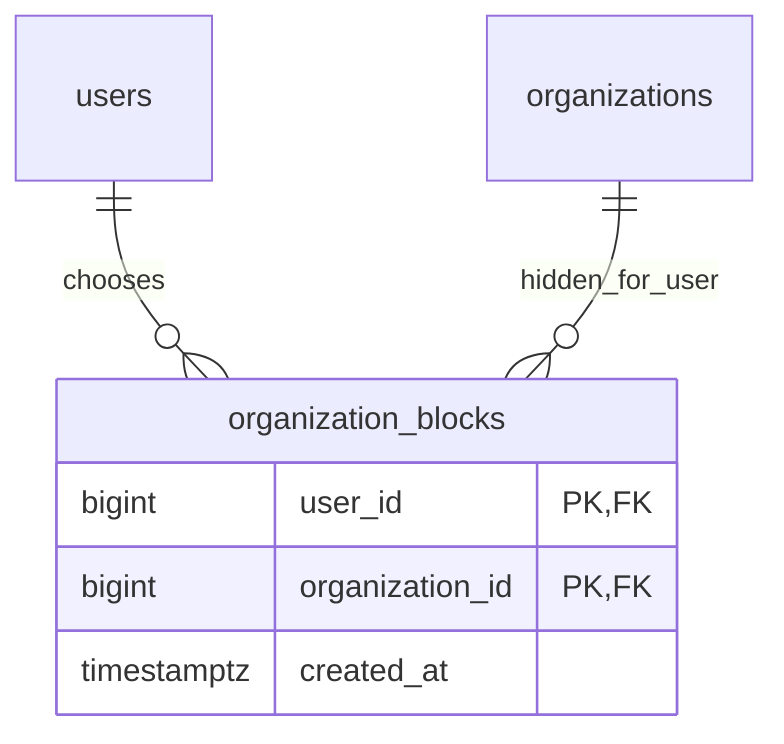

# 40. Hoàn thiện chức năng BE — 2026-10-14

Phạm vi theo yêu cầu chủ dự án: quản lý phiên, tìm kiếm, xóa nháp, report/hỗ trợ Admin, audit và phiếu lý do. Trong lượt này chủ dự án thay chức năng Admin chặn bằng **Admin gỡ sự kiện**, và yêu cầu **Customer ẩn Organizer** như lựa chọn cá nhân. Quyết định ADR-035 thay phần Admin block/unblock cũ; không thay Google/email OTP, JWT 10 phút, refresh 7 ngày tuyệt đối, linking hoặc Origin/CSRF. Giữ Modular Monolith một API và worker cùng codebase.

## Quyết định hiện hành

- Admin gỡ event đã duyệt: PUBLISHED → ARCHIVED; ngừng hiển thị, bán mới, xác nhận tiền để phát vé, check-in và vào cửa. Giữ đơn/vé/payment/ghế SOLD/lịch sử. Không lập refund hoặc xử lý đền bù do gỡ; chủ dự án xác nhận phần đó ngoài hệ thống. Luồng Organizer tự hủy/refund thủ công đã chốt ở ADR-032/034 vẫn giữ phạm vi riêng.
- Admin không có endpoint chặn/mở chặn User trong phạm vi này. User.status BLOCKED và việc từ chối phiên không bị xóa khỏi cơ chế bảo vệ hiện có. Các permission cũ trong seed không được biến thành API mới hoặc tự cấp thêm quyền.
- Customer ẩn một Organization qua public Organizer ID: không thấy sự kiện/tên sự kiện của Organizer đó trong catalog cá nhân, Home, gợi ý, merchandise/catalog thay đổi và thông báo mở bán do follow. Không khóa tài khoản Organizer, không đổi quyền, follow, đơn/vé, tiền hoặc catalog của Guest/người khác. Bỏ ẩn khôi phục khả năng xem; đây là lựa chọn hiển thị, không phải rào cản truy cập hoặc cấm mua vé.
- Can thiệp Admin vẫn cần report IN_REVIEW được giao đúng tài nguyên, permission và audit theo ma trận đã chốt. Đóng report thu hồi quyền đọc booking/gỡ tiếp theo, kể cả replay key. Người có report.handle nhưng thiếu vai trò ADMIN không được dùng hàng đợi/can thiệp Admin.

## API và payload

Prefix `/api/v1`. ID/tiền là chuỗi, mutation strict schema; private response no-store. Swagger/OpenAPI có các route thực đã mount.

| API | Hợp đồng |
| --- | --- |
| GET `/auth/sessions?page=1&pageSize=20` | Chỉ phiên còn hoạt động của chính User; id/deviceLabel/provider/authenticatedAt/createdAt/expiresAt/current và pagination. Không token/hash/family/email/subject |
| DELETE `/auth/sessions/{sessionId}` | Bearer + Origin + double-submit CSRF. Chỉ phiên chính mình; lặp thu hồi phiên khác trả204, không ghi audit trùng; thu hồi phiên hiện tại xóa refresh cookie |
| POST `/auth/logout-all` | Body `{}`, Bearer + Origin + CSRF; tăng authVersion và thu hồi mọi phiên cùng transaction, xóa refresh cookie; token cũ bị từ chối ngay |
| GET `/events` | Thêm from/to ISO có offset, minPrice/maxPrice minor VND, available=true/false; sort recommended/date_asc/date_desc/price_asc/price_desc. Khoảng ngày `[from,to)`, khoảng giá bao gồm hai đầu. Ngày/địa điểm/giá/ghế trống phải thuộc cùng suất và cùng ghế khi kết hợp giá/availability; chọn suất đầu tiên khớp. Ghế hold hết hạn là ứng viên, vẫn revalidate dưới khóa khi đặt |
| DELETE `/organizer/events/{id}` | Body `{version}` + Bearer/Origin; chỉ DRAFT thuộc scope và không có dữ liệu phụ thuộc.409 khi version/status sai hoặc FK phụ thuộc; không cascade, không xóa lịch sử |
| POST `/reports` | `{eventId,bookingId?,reason}`, Idempotency-Key. Booking phải của người gửi và thuộc event; report không booking cần membership ACTIVE của tổ chức hoặc booking của mình thuộc event |
| GET `/reports`, `/reports/{id}` | Người gửi đọc của mình; Organizer chỉ report event không có booking trong tổ chức APPROVED/membership ACTIVE và quyền report.handle. Admin đọc hàng đợi report metadata; không tự cấp quyền đọc booking |
| GET `/admin/reports` | Admin + report.handle; status/page/pageSize |
| POST `/admin/reports/{id}/claim` | `{version}` + key; chỉ OPEN đúng version, không nhận của Admin khác |
| POST `/admin/reports/{id}/resolve` | `{version,resolution}` + key; Admin được giao đóng report, dùng cùng service của refund/report hiện có |
| GET `/admin/bookings/{id}?reportId=...` | booking.read_support + ADMIN/report.handle và report IN_REVIEW được giao đúng booking/event. DTO trạng thái/tổng tiền/itemCount/payment id-status-amount; không attendee/QR/CCCD/SĐT/URL thanh toán. Có audit cho lần đọc |
| POST `/admin/events/{id}/unpublish` | `{version,reportId,reason}` + key; ADMIN/event.review/report.handle, phiên xác thực mới trong5 phút; đúng event/version/report. Gỡ về ARCHIVED, audit lý do; không job hoàn tiền/đền bù |
| GET `/admin/audit-logs` | audit.read; from/to/resourceType/resourceId/reportId/action/page/pageSize. Metadata action/actor/resource/request/time, phân trang ổn định. Scope review theo event.review/organizer.approve, hoặc report được giao theo report.handle; không xuất reason/raw before-after/credential/PII. Lịch sử audit của report đã đóng vẫn có thể tra cứu metadata, nhưng không mở lại scope can thiệp |
| GET `/admin/reason-notices` | Hàng đợi phiếu DRAFT, page/pageSize |
| GET `/admin/event-reviews/{id}/reason` | Metadata nhận diện, notice và preview plain text; không HTML |
| PUT `/admin/event-reviews/{id}/reason` | `{version,reasonCode,reason,guidance}` + key; version của phiếu (chưa có thì0), review PENDING/EXPIRED. Cho phép reason trống khi đang soạn; lưu chưa gửi notification |
| POST `/admin/event-reviews/{id}/reason` | Gửi phiếu EXPIRED theo API hiện có, reason phải có nội dung; reasonCode tùy chọn để giữ tương thích. SENT bất biến |
| POST `/admin/event-reviews/{id}/reject` | API cũ thêm reasonCode tùy chọn; quyết định/từ chối/gửi phiếu trong cùng transaction. Phiếu nháp chuyển SENT, giữ identity/version/lịch sử |
| GET `/users/me/blocked-organizers` | Customer đọc danh sách đã ẩn, page/pageSize |
| PUT `/users/me/blocked-organizers/{publicOrganizerId}` | Body `{}`, Bearer/Origin; Customer đã onboarding. Upsert quan hệ, lặp an toàn |
| DELETE `/users/me/blocked-organizers/{publicOrganizerId}` | Bearer/Origin; bỏ ẩn,204, lặp an toàn |

reasonCode allowlist: REVIEW_EXPIRED, REVIEW_REJECTED, MISSING_INFORMATION, INVALID_CONFIGURATION, OTHER. Giá/ID vượt BIGINT, query lặp/array, khoảng đảo, sort ngoài allowlist và trường client tự gửi excludedForUserId đều bị từ chối. q giữ hành vi ILIKE hiện có; chưa đổi chính sách dấu/hoa thường.

Catalog `/catalog/home`, `/events`, `/events/{id}`, `/organizers`, `/organizers/{id}`, `/merchandise`, `/merchandise/{id}`, `/event-change-requests` nhận Bearer JWT **tùy chọn** để áp dụng lựa chọn ẩn. Không có JWT thì Guest. Có header sai/hết hạn thì401, không hạ xuống Guest. Response cá nhân no-store/Vary Authorization; FE phải gửi Bearer để nhận feed cá nhân. Category/location chỉ là số liệu catalog chung. API giữ đơn/vé/checkout không dùng block làm quyền.

## Dữ liệu, khóa và nâng cấp

Đã kiểm tra metadata DB local, DDL và migration: organization_follows chỉ có preference notification, Users chưa có quan hệ ẩn. Không dùng mute để giả lập block hoặc tạo một follow ngầm khi ẩn. Một bảng nhiều–nhiều organization_blocks là vòng đời riêng, khác Users và Organization, không phải bảng1:1/bản sao profile.

Migration014 chỉ tạo bảng/index quan hệ, không thêm field vào credential/đơn/vé hoặc role grants; fresh schema gồm014, kết quả47 bảng. Database đã có013 cần backup/review rồi chạy014 một lần; DB rỗng chỉ dùng schema.sql và seed. Giữ dữ liệu preference khi rollback app; không drop bảng hoặc xóa lịch sử giao dịch để rollback. Sơ đồ Mermaid hiện hành của phần bổ sung nằm ngay trên; bộ SVG cũ đã bị xóa từ trước, không dựng lại.

Thu hồi/logout-all/refresh dùng khóa User trước Session, revalidate phiên/authVersion và ghi audit cùng transaction; không đổi token TTL hoặc rotation. Phiếu dùng Event → Review → Notice, optimistic version; gỡ dùng User/permission → report → Organization → Event UPDATE. Các luồng mua/vào cửa đang khóa Event SHARE phải kết thúc trước khi gỡ commit; sau commit chúng đọc lại trạng thái và bị từ chối. Readiness yêu cầu organization_blocks. Public snapshot ghế revalidate event trước đọc Redis cache; cache không thay quyền hiển thị hoặc quyền mua.

## Kiểm chứng và giới hạn

- `npm run check` cuối qua:91 unit/HTTP/config/architecture tests; secret guard/lint/typecheck/build/format đều qua.
- PostgreSQL tạm:51 passed/1 browser skipped; fresh schema và populated upgrades007–014 khớp. Bao gồm tranh chấp refresh/logout-all, IDOR/CSRF/Origin/role/report, same-session/same-seat date-price-availability, private feed/notification, FK delete/version, notice draft/reject/SENT/idempotency resource, reauthentication Admin, cache ghế sau gỡ, giữ paid history và không tạo refund. Provider/chứng từ là fixture, không tiền thật. Không chạy browser FE trong lượt này.
- DB local đã backup `backups/before-014-1791972755106.dump` (254724 bytes, pg_restore --list qua) rồi áp dụng014 trong transaction;47 bảng và fingerprint auth/role/đơn/vé/tiền/audit/follow giữ nguyên. Không account/role grant/giao dịch mới. Không chạy014 lại; rollback app giữ preference/lịch sử, hoặc restore backup vào DB riêng theo quy trình đã có.
- HTTP đọc trên DB local: schema check qua, catalog/filter/Home/OpenAPI200; API riêng tư mới401 khi không login. **Readiness503 vì Redis đã cấu hình hiện không kết nối**, không phải thiếu014. Chưa tự thay cấu hình hoặc nới kiểm tra dependency để che lỗi. Cần chạy Redis đã được duyệt khi dùng commerce local; command hiện có `npm run infra:redis` nếu dùng Docker của project. Không khẳng định toàn runtime local đã ready.
- Pool/Redis/server kiểm tra và PostgreSQL/profile fixture đã đóng/dọn; BE/tmp rỗng. Giữ backup đã kiểm chứng ngoài Git. Không đo tải/gửi OTP/provider thật/chuyển hoặc hoàn tiền/cấp Admin vận hành/thay FE/infra.

Merchandise mua/kho/giao hàng, thuật toán uy tín và thay lịch/tăng sức chứa/mở bán lại vẫn cần chính sách Q-019/Q-021/Q-022; không coi catalog đọc hoặc feedback stars là đã hoàn thiện các luồng đó. Hosting/staging/MFA và vận hành production vẫn ngoài phạm vi hoàn thiện chức năng BE lần này.

## Bổ sung indoor/outdoor — 2026-10-14

BE outdoor theo khu/sức chứa đã triển khai tại [Docs42](42-outdoor-zone-ticketing.md): quantity hold, giá theo khu, cùng lifecycle thanh toán/vé/check-in/refund/cancel, migration016 không bảng mới. Health Admin/API đã đồng bộ ES; các ghi nhận readiness503 ở lượt014 phía trên là lịch sử, không kết luận runtime hiện tại. Membership/CMS/merchandise/uy tín và FE editor/picker khu vẫn ngoài phần này.
