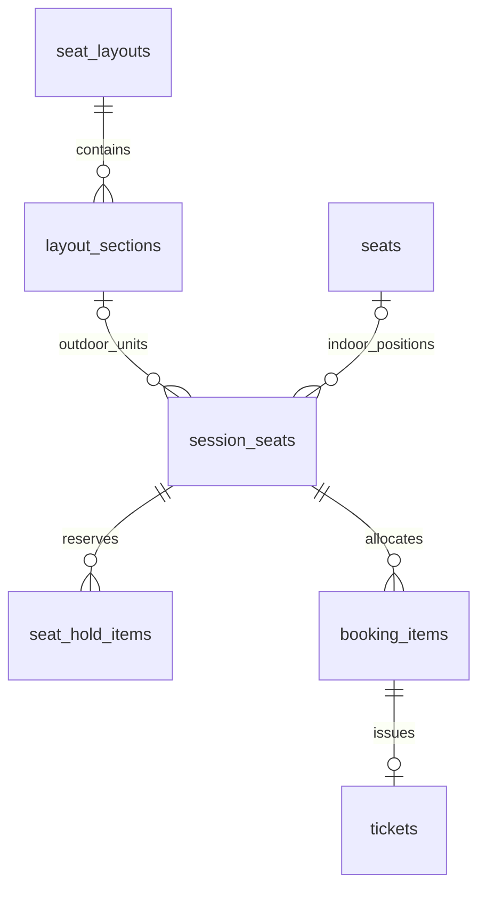

# Indoor/outdoor BE — ADR-037 / 2026-10-14

Chủ dự án yêu cầu hoàn thiện BE outdoor theo khu, trong khi indoor dùng ghế đánh số; sửa health Admin và đồng bộ README trước. API vẫn Modular Monolith một instance, PostgreSQL là nguồn tồn kho, Redis/Elasticsearch/R2/worker hiện có. Không thêm dịch vụ, broker hoặc hệ phân tán.

## Health thống nhất

checkRuntimeReadiness kiểm tra Redis, Elasticsearch khi cấu hình và worker theo profile. Cả startup/dependencies (health/ready) và OperationsService (Admin health) dùng hàm này; bỏ probe ES riêng trùng ở startup. Khi ES hỏng, Admin trả ready=false; health/ready trả503. Permission statistics.read_system, no-store và DTO không credential giữ nguyên.

READMEs organizations/layouts/sessions/venues đã thay các placeholder sai: application/approval đã có; layouts/sessions triển khai qua events/management; venue catalog đọc có, maintenance chưa có. Tài liệu cũ về quantity chưa triển khai được thay trong phạm vi backend ở tài liệu này; FE editor chưa được triển khai.

## API Organizer

Tạo DRAFT qua POST /api/v1/organizer/events với ticketingMode NUMBERED (mặc định để tương thích indoor) hoặc QUANTITY (outdoor). Mode giữ cố định trên event; PATCH nội dung không nhận mode. Không tự thay mode/dữ liệu sự kiện đang bán. Scope/membership, Organization approval, review deadline/version/idempotency/Origin và R2 ảnh giữ hiện hành.

| API | Payload / hành vi |
| --- | --- |
| POST /organizer/events/{id}/zone-layouts | version,venueId,stage?,blocked?,zones:[{code,name,capacity,x,y,width,height}] |
| POST /organizer/events/{id}/sessions | layoutId + cửa sổ sale/counter/admission như indoor; layout phải cùng event/mode |
| POST /organizer/events/{id}/sessions/{sessionId}/ticket-types | Loại vé của suất theo API hiện có |
| PUT /organizer/events/{id}/sessions/{sessionId}/zone-prices | version,prices:[{sectionId,ticketTypeId,priceMinor,currency:"VND"}]; mỗi khu đúng một loại vé/giá |
| GET /organizer/events/{id} | Graph bổ sung zones (id/layout/code/name/capacity/geometry), layouts/event có mode |
| POST /organizer/events/{id}/submit | Kiểm tra giá toàn bộ khu, ảnh và điều kiện gửi; đóng băng snapshot |
| POST /admin/event-reviews/{id}/approve | Chỉ khi tổ chức APPROVED; tạo tồn kho đủ sức chứa và publication QUANTITY, không tạo physical seat |

Khu/stage/blocked dùng rectangle trong bounds venue đã snapshot. Tối đa100 khu, mã riêng biệt; khu không chồng khu/stage/vùng cấm; tổng capacity không vượt venue và trần kỹ thuật100000 units/suất. Không suy diện tích thành capacity: Organizer khai sức chứa và Admin duyệt, không bịa số đo địa điểm thật. Các hình học khác chưa hỗ trợ. Giá là chuỗi minor VND nguyên dương trong Number.MAX_SAFE_INTEGER để tương thích payOS hiện có.

## API khách mua

GET /events/{publicEventId}/sessions/{sessionId}/zones trả layout stage/blocked/canvas và danh sách sectionId/code/name/capacity/geometry/type/price/currency/available/sold. Chỉ PUBLISHED + APPROVED, suất đúng event; không trả allocation owner, QR/PII hoặc danh sách slot nội bộ. Available gồm AVAILABLE và HELD đã hết hạn; hold vẫn kiểm tra lại dưới khóa. Giá/availability filters và search PostgreSQL đã nhận cả inventory outdoor; số liệu sales/attendees/tickets dùng cùng booking/payment.

POST /events/{publicEventId}/sessions/{sessionId}/zones/hold nhận `{zones:[{sectionId:"123",quantity:2}]}`. Strict input, không khu trùng, số lượng nguyên dương, tổng tối đa6 vé dù chia nhiều khu. Bearer Customer/onboarding, Origin, key, limiter/phòng chờ như indoor. Server chọn units, nhóm giữ nguyên tử, thiếu một khu rollback toàn bộ. Endpoint seats/hold không cấp vé outdoor qua ID nội bộ.

Hold5 phút, checkout không gia hạn, một phân bổ còn hạn/user/suất; replay cùng key/body trả cùng hold, key khác payload bị từ chối. Hold DTO thêm sectionId/zoneName cho outdoor; sessionSeatId legacy là ID allocation unit để khai attendee/checkout, không phải ghế có vị trí. Checkout/payment/attendees dùng API hiện có, mỗi unit là một booking item và một người tham dự/vé/QR riêng. Snapshot seatLabel legacy lưu tên khu, không thêm số ghế giả.

Expired/release/cancel booking nhả đúng units. Thanh toán chỉ confirm allocation còn hạn, callback muộn không hồi sinh vé. Refund thủ công, Organizer hủy và Admin gỡ theo chính sách hiện có: vé refund/cancel không được vào cửa, không tự mở bán lại units SOLD. Check-in và admission tách riêng, USED một lần, tuổi/giấy tờ/ownership giữ nguyên. Admin gỡ không lập đền bù; Organizer hủy có xử lý hoàn thủ công đã chốt.

## Schema và khóa

Migration016 dùng lại47 bảng: events.ticketing_mode, seat_layouts.ticketing_mode; layout_sections thêm capacity/geometry_json cho outdoor. session_seats giữ tên legacy nhưng là inventory unit: indoor seat_id, outdoor section_id + inventory_number, XOR CHECK. Outdoor không có seats/layout_rows giả. FK section/layout/session/type, unique(session,section,inventory_number), trigger kiểm tra mode/ordinal≤capacity và NOT NULL bảo vệ số units không vượt capacity.

Mỗi outdoor unit là một quyền vào cửa có vòng đời độc lập, không phải bản sao khu hoặc physical seat. Không thêm counter/kho song song: tính available/sold từ units PostgreSQL. Lock quota → Organization/Event/Session → Hold/Booking → units ID tăng dần → Payment/Refund/Ticket như giao thức hiện hành. Zone request sort section ID, inventory tạo theo section ID tăng dần để cùng thứ tự; expired allocation cleanup/retry dùng worker/service hiện có. Không network trong transaction.

Migration backfill mode từ admission_type QUANTITY có sẵn, giữ timestamp cũ; không tự tạo khu hoặc inventory cho catalog demo cũ chưa có cấu hình. DB có015 backup/review rồi apply016 một lần; DB mới dùng schema.sql. Backup/kiểm chứng thực tế ghi trong Docs26. Khôi phục bằng backup vào DB riêng cùng release trước016; không DROP lịch sử đang phục vụ. Search index không chứa mode/tồn kho, PG hydrate hiện hành; không cần rebuild analyzer/index cho016.

## Kiểm chứng và giới hạn

Đã chạy PostgreSQL fresh/populated007–016 và luồng NUMBERED/QUANTITY: draft trước org approval, freeze/publish, race mua vượt capacity, rollback khi một khu sai, expiry/release, key replay, thanh toán/provider fixture/dedup, attendees, QR/check-in/USED, full manual refund và Organizer cancellation/compensation. Outdoor không tạo physical seats, vé giữ tên khu; DB từ chối ordinal vượt capacity/NULL. GET zones và unauthorized POST được kiểm tra. Unit kiểm tra zone overlap/duplicate/capacity/limit6; readiness ES failure/success qua probe an toàn. Không chuyển/hoàn tiền thật.

Luồng FE kéo thả hoặc picker khu chưa nối trong lượt BE này. Mỗi khu hiện một loại vé/giá, không mixed indoor/outdoor cùng event, không resale/chuyển nhượng/mở lại SOLD, không sửa capacity/lịch của sự kiện đã công bố, không benchmark100000 units. Không dùng tuyên bố “BE hoàn chỉnh toàn bộ sản phẩm” cho merchandise/CMS/membership/uy tín còn ngoài phạm vi này.

Kiểm chứng cuối2026-10-14: BE97 unit/HTTP/config/architecture + lint/typecheck/build/format/secret guard qua; PG/ES59 passed/2 browser skipped. DB local đã apply016 sau backup backups/before-016-1791983829678.dump263060 bytes (pg_restore --list qua), vẫn47 bảng; fingerprint mọi giá trị lịch sử và timestamps giữ nguyên khi loại đúng các cột mới. Không chạy016 lại. Smoke health/ready200, search200/Elasticsearch, Admin health401 khi chưa login, Swagger4 outdoor paths. Fixture PG/index/API key đã dọn, BE/tmp rỗng; không provider/tiền thật hoặc FE mới.
