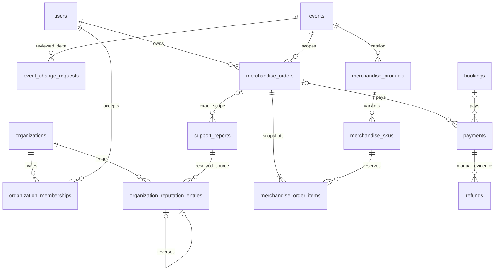

# 44. Merchandise, mở bán lại, membership và uy tín — BE v1

Chủ dự án chấp thuận toàn bộ bộ quy tắc trong hội thoại ngày2026-10-15. ADR-038/Q-036 thay trạng thái chờ của bốn phần này; CMS để sau v1. Bốn phần đã triển khai và qua nghiệm thu code/local; bằng chứng kiểm tra/migration/restore tại [Docs26](26-auth-progress.md). Chưa chạy giao hàng hoặc chuyển/hoàn tiền thật. Giữ Modular Monolith một API, PostgreSQL/Redis/R2/Elasticsearch và hai worker hiện có; không thêm hạ tầng phân tán.

## Membership

Chủ hồ sơ Organization mời User đã onboarding ORGANIZER; người nhận chấp nhận mới ACTIVE. Thành viên dùng permission Organizer đã có, không cấp role mới hoặc tự bật Customer/Admin. Chỉ chủ hồ sơ được mời/thu hồi, không chuyển chủ hoặc thu hồi chính chủ. Organization phải APPROVED cho thao tác vận hành. INVITED riêng PENDING hồ sơ tổ chức để lời mời chưa nhận không được tạo draft hoặc xem dữ liệu tổ chức. Reinvite và mọi mutation dùng version/idempotency, kiểm tra quyền lại khi replay; thu hồi tác dụng trên request tiếp theo.

GET `/organizer/organizations` đọc tổ chức APPROVED mà actor có membership ACTIVE, gồm id/publicId/name/membershipId/isOwner và pagination; không identity/email. Không thay danh sách hồ sơ ứng tuyển của chủ hồ sơ.

## Uy tín nội bộ

Chỉ Admin/Organizer đúng tổ chức xem. Dùng feedback ORGANIZATION xác thực, VISIBLE; không SYSTEM hoặc review ẩn. `R=(sumStars+5*3)/(count+5)`; thành phần sao `100*(R-1)/4`. Cộng tổng bút toán điều chỉnh rồi clamp0–100, hiển thị chưa đủ dữ liệu và score=null nếu dưới5 đánh giá. Không decay, tự approve, khóa hoặc suy quyền từ điểm.

Admin điều chỉnh mỗi nguồn report đã RESOLVED tối đa±20, có lý do, đúng tổ chức/report được xử lý. Nguồn duy nhất, không cộng/trừ lặp; đảo bằng bút toán liên kết, không sửa/xóa lịch sử. Sửa/ẩn/khôi phục feedback làm tính lại thành phần sao hiện hành. Lưu snapshot khi quyết định duyệt; lịch sử xét duyệt không đổi theo điểm mới.

## Mở bán lại

NEW_SALE_WAVE cấu hình cửa sổ đợt bán trên chỗ chưa bán; CAPACITY thêm inventory trong giới hạn venue cho indoor/outdoor. Organizer gửi reason/version/snapshot, Admin duyệt trước hiệu lực; reject/withdraw không đổi bản công bố. Chặn khi event đã hủy/gỡ hoặc suất đã bắt đầu. Giữ lịch/địa điểm, giá/chỗ/vé/hold cũ; không hồi sinh ghế SOLD/đã hoàn hoặc chuyển nhượng vé.

Cửa sổ còn mở chỉ được gia hạn, không thu hẹp hoặc dời sang tương lai làm mất hiệu lực hold. Đợt cũ đã đóng có thể cấu hình cửa sổ mới trong tương lai, vẫn không quá giờ bắt đầu suất. Mỗi event chỉ có một yêu cầu CAPACITY/NEW_SALE_WAVE PENDING; Admin kiểm tra lại event version và giờ DB khi duyệt. CONTENT thay version làm yêu cầu cũ cần rút/gửi lại.

CAPACITY là delta được duyệt: indoor chỉ nối thêm ghế/nhãn/hình học không chồng lấn; outdoor tăng capacity khu hoặc nối thêm khu. Không di chuyển/xóa/sửa ghế/khu cũ. Snapshot duyệt cũ giữ nguyên; version mới và hồ sơ thay đổi lưu phần bổ sung. Approval lặp không nhân tồn kho. Khóa Event rồi session/layout/inventory để không thay bản đang phân bổ; mọi hạn tính bằng giờ DB sau khóa.

Layout có thể được nhiều suất dùng chung. Tồn kho chỉ bổ sung vào suất được duyệt: ghế vật lý đã có nhưng chưa hề có inventory ở suất đó được dùng đúng nhãn/hình học; inventory đã có, kể cả SOLD/REFUNDED, không được tạo lại. Outdoor tăng số thứ tự inventory từ mức hiện có của chính suất, không lấy capacity vật lý của suất khác làm mốc. Capacity hình học dùng giá trị lớn nhất; không hạ capacity của layout.

## Merchandise

Đơn riêng trong một sự kiện, SKU/biến thể và tồn kho độc lập vé. Tối đa20 đơn vị/đơn, giữ kho5 phút, checkout không kéo dài hạn; cùng kênh payOS VND. Không có guest checkout, giỏ nhiều event/Organization hoặc giả merchandise thành booking vé. Giá/ship/địa chỉ/dòng hàng chụp vào đơn, sửa catalog không đổi đơn cũ.

Organizer cấu hình phí giao cố định trong Việt Nam, tự xử lý/tracking/chứng từ; không tích hợp hãng vận chuyển mới. Admin duyệt sản phẩm trước bán. Điều kiện có vé được cấu hình theo sản phẩm, server kiểm tra vé VALID/USED thuộc người mua và cùng event lúc đặt và xác nhận tiền. Callback trùng không nhân đơn/trừ kho; tiền muộn/thiếu/dư hoặc mất điều kiện vào đối soát, không chiếm lại hàng.

Phí được cấu hình trên sản phẩm; đơn nhiều sản phẩm lấy **phí cố định cao nhất một lần**, FE đọc phí và tổng tiền từ server. SKU/giá/nội dung sửa ở DRAFT/REJECTED; sản phẩm đã bán chỉ bổ sung stock hoặc ARCHIVED, không sửa giá snapshot. Stock không được giảm. Catalog demo cũ không có SKU vẫn đọc được, không tự suy ra tồn kho để bán.

Full manual refund trước bàn giao vận chuyển, có chứng từ và reference duy nhất. Shipment/refund kiểm tra lại dưới cùng khóa đơn/kho. Sau khi giao hoặc event hủy, xử lý ngoại lệ qua report đúng tài nguyên; không giả đã chuyển tiền hoặc tự đánh dấu hoàn. Không tự tái nhập hàng đã giao. Thông tin giao hàng chỉ chủ đơn/Organizer đúng scope được đọc; không ghi PII vào audit/log hoặc outbox provider.

Địa chỉ được AES-256-GCM bằng khóa HKDF riêng từ ATTENDEE_PII_KEY, AAD là order ID. API list không có địa chỉ; detail của chủ đơn có địa chỉ, Organizer chỉ đọc địa chỉ đơn CONFIRMED để giao; Admin theo report chỉ thấy metadata/tiền. Không đưa địa chỉ vào payOS/outbox/audit. Worker bookings hiện có hết hạn đơn, nhưng reserve tự hết hiệu lực theo giờ DB ngay cả khi worker dừng. Confirm mới tăng sold_quantity; full refund SUCCESS trước giao giảm sold_quantity đúng một lần. REQUESTED/PROCESSING/FAILED refund chặn giao. Gửi SHIPPED mới bị chặn khi event không còn PUBLISHED; có thể ghi nhận kết quả DELIVERED/DELIVERY_FAILED của kiện đã giao vận chuyển.

Ngoại lệ: Customer hoặc Organizer tạo report có merchandiseOrderId + đúng eventId; Admin nhận report rồi đọc đúng đơn và chuẩn bị COMPENSATION bằng toàn bộ tiền thực nhận của payment. Ghi SUCCESS sau khi chuyển tiền ngoài hệ thống, có evidence/reference/thời gian hợp lệ. Một khoản full refund không bị ghi lặp; nếu tiền mới tiếp tục về sau refund, webhook vẫn giữ FUNDS_AFTER_REFUND/REQUIRED cho xử lý hỗ trợ và đối chiếu ngân hàng, không tự chuyển tiền lần nữa.

## Hợp đồng FE

Mọi path dưới `/api/v1`; private GET no-store, mutation cần Bearer, Origin và Idempotency-Key. ID/tiền là chuỗi; version là số nguyên. Response dùng `{data,meta}` hiện có. OpenAPI `/openapi.json` chứa schema request strict; không gửi trường giá/tổng/quyền do FE tự tính vào order.

| Luồng | API |
| --- | --- |
| Chọn tổ chức | GET `/organizer/organizations?page&pageSize` |
| Thành viên | GET/POST `/organizer/organizations/{organizationId}/members`; POST body `{userId,version}`. GET `/organizer/membership-invitations`; POST `/organizer/memberships/{id}/accept`, `/decline`, `/revoke` body `{version}` |
| Uy tín | GET `/organizer/organizations/{organizationId}/reputation` hoặc `/admin/.../reputation`, có page/pageSize. POST `/admin/organizations/{organizationId}/reputation/adjustments` body `{reportId,delta,reason}`; POST `/admin/reputation/{id}/reverse` body `{reason}` |
| Mở bán | GET/POST `/organizer/events/{eventId}/sale-changes`; GET `/admin/sale-changes`; POST `/admin/sale-changes/{id}/approve`, `/reject`, `/organizer/sale-changes/{id}/withdraw` body `{version,reason}` |
| Tạo hàng | GET/POST `/organizer/events/{eventId}/merchandise`; POST body `{name,description,requiresTicket,shippingFeeMinor,skus:[{code,name,priceMinor,stockTotal}]}` |
| Sửa/duyệt hàng | GET/PATCH `/organizer/merchandise/{id}`; PATCH `{version,product:...}`. POST `/submit`, `/archive` và `/admin/merchandise/{id}/approve`, `/reject` body `{version,reason}`. Admin GET `/admin/merchandise?status&page&pageSize`, GET `/admin/merchandise/{id}` |
| Ảnh hàng | Media upload hiện có, purpose=merchandise, targetId=product ID, **version của product**; complete tăng product.version, không tăng event.version. Cần DRAFT và ảnh R2 được kiểm chứng trước submit |
| Bổ sung kho | POST `/organizer/merchandise-skus/{id}/stock` body `{version,stockTotal}`. SKU.version đổi khi bán/hoàn/thêm stock, tải lại trước sửa |
| Chọn SKU | GET `/merchandise/{publicId}/skus`: eventId/productId số dạng chuỗi, shippingFeeMinor, skus `{id,code,name,priceMinor,currency,available}`. Available chỉ là ảnh chụp; server khóa/recheck khi đặt |
| Đặt hàng | POST `/merchandise-orders` body `{eventId,items:[{skuId,quantity}],recipient:{name,phone,address,country:"VN"}}`; tối đa20 đơn vị, một event |
| Đơn của tôi | GET `/users/me/merchandise-orders?page&pageSize`; GET `/{id}`; POST `/merchandise-orders/{id}/cancel` body `{version}` |
| Trả tiền | POST `/merchandise-orders/{id}/payments` body `{}`; sau redirect dùng GET `/payments/{id}` hiện có. DTO có merchandiseOrderId, bookingId=null; outcome/receivedMinor/reconciliation giống vé. Return/cancel URL mang merchandiseOrderId, không mang bookingId |
| Giao hàng | GET `/organizer/organizations/{organizationId}/merchandise-orders`; GET `/organizer/merchandise-orders/{id}`; POST `/{id}/fulfillment` body `{version,status,reference,note}`. UNFULFILLED→SHIPPED→DELIVERED/DELIVERY_FAILED; DELIVERY_FAILED→SHIPPED được ghi lại tracking |
| Hoàn trước giao | POST `/merchandise-orders/{id}/refunds` body `{reason}`. GET `/users/me/merchandise-orders/{id}/refunds` hoặc `/organizer/merchandise-orders/{id}/refunds` |
| Ghi tiền hoàn | POST `/organizer/merchandise-refunds/{id}/approve`, `/reject`, `/retry`, `/result`. Decision `{version,reason}`, result dùng schema refunds hiện hành `{version,status:"SUCCESS",reference,evidenceNote,transferredAt}` hoặc FAILED + reason |
| Report ngoại lệ | POST `/reports` body `{eventId,merchandiseOrderId,reason}`; không kèm bookingId. Claim/close qua report API hiện có. GET `/admin/merchandise-orders/{id}?reportId=...`, GET `/{id}/refunds?reportId=...`; POST `/admin/merchandise-payments/{paymentId}/refunds` body `{reportId,reason}`. Admin refund actions như Organizer, bắt buộc reportId đúng đơn/được giao/IN_REVIEW |
| Báo cáo | GET `/organizer/organizations/{organizationId}/merchandise-sales?from&to`. Admin statistics thêm nhóm merchandise riêng, không cộng vào grossTicketSalesMinor |

Product detail trả các field snapshot hiện có bằng snake_case và `skus` (gồm id/version/stock_total/sold_quantity). Order detail dùng camelCase: id/eventId/organizationId/status/fulfillmentStatus/totalMinor/shippingFeeMinor/currency/expiresAt/version/trackingReference/fulfillmentNote/shippedAt/deliveredAt/items/payments và recipient khi đủ scope. Dòng items dùng tên cột snapshot snake_case, quantity/price_minor; payments không có credential/checkout URL. List trả `{items,total}` và dùng page/pageSize đã gửi; membership invitations/member list và reputation history tương tự.

Đối soát không đồng nghĩa mua thành công: chỉ outcome=SUCCESS cùng order CONFIRMED mới hiển thị mua thành công; không tin query return URL hoặc chỉ payment.status=SUCCESS khi có tiền muộn/dư. Khi hết5 phút hoặc báo conflict, tải lại order/stock, không kéo dài expiresAt bằng checkout/retry. Idempotency replay trả trạng thái hiện hành, không phục hồi đơn/lời mời đã bị thu hồi.

## ERD bổ sung migration017

Payments có XOR booking_id/merchandise_order_id, provider key/reference/webhook inbox và refund full-payment guard dùng chung. FK confirmed_payment ràng đúng order; report FK đúng order/event. Bốn bảng mới có vòng đời nhiều–một, schema hiện hành51 bảng. Không xóa lịch sử/refund/ledger khi archive, hủy hay thu hồi membership.

## Dữ liệu và nghiệm thu

Đã đọc metadata DB local: membership/product/event_change_requests/payment/refund/feedback hiện có, không có SKU/merchandise order hoặc ledger uy tín tương đương. Ưu tiên mở rộng bảng hiện có; bảng mới chỉ cho SKU, đơn/dòng hàng và bút toán nhiều–một có vòng đời riêng. Không thêm bảng1:1 hoặc cache điểm song song với nguồn.

Migration017 bổ sung additive sau016, canonical schema phải khớp fresh/populated upgrade. Không chạy migration lên DB local trước khi test/backup/review. Thứ tự khóa và ràng buộc XOR/FK/unique phải giữ dữ liệu booking/vé/provider hiện có. Rollback app giữ dữ liệu mới, hoặc restore backup vào DB riêng, không xóa giao dịch để rollback.

Nghiệm thu: API/OpenAPI/strict validation/Origin/ownership/no-store; idempotency và quyền sau revoke; tranh chấp kho/capacity/refund/shipment; webhook trùng/tiền muộn; không sửa ghế/vé cũ; ledger nguồn duy nhất/đảo; snapshot và tính lại review. `npm run check:v1` cùng fixture PostgreSQL/Elasticsearch, ghi rõ số passed/skipped và giới hạn provider/production tại Docs26 trước khi chốt v1.

Kết quả cuối2026-10-15: check:v1 qua,97 unit/HTTP và88 ca runner PG/search,2 browser tùy chọn skipped; fresh/populated017 khớp. Local017 đã COMMIT với47 bảng cũ/40 sequence giữ nguyên; db:check và restore51 bảng/351 dòng khớp. API smoke chỉ đọc200/401 đúng scope. Xem Docs26 cho backup/cleanup và giới hạn provider.
