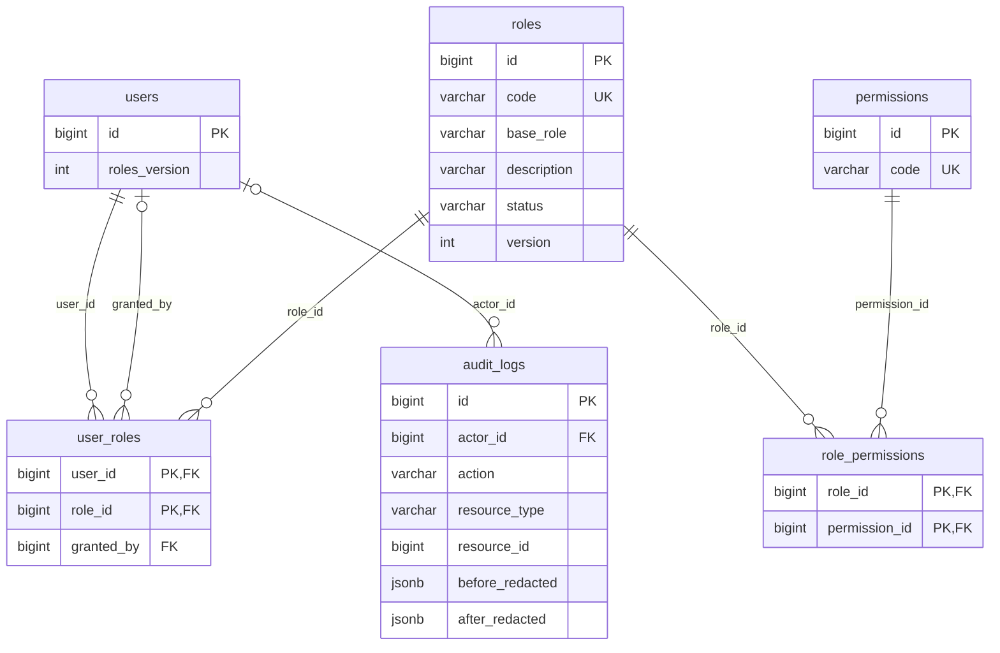

# 46. Quản trị RBAC động

Chủ dự án chốt 2026-10-15 / ADR-040 / Q-038: ADMIN có `rbac.manage` quản trị role tùy chỉnh và được cấp/thu hồi ADMIN cho người khác. Migration018 cấp permission này cho role ADMIN đã có, **không tạo tài khoản hoặc cấp UserRole mới**. Bootstrap Admin đầu tiên vẫn là thao tác vận hành kiểm soát.

## Chính sách

- Mọi API đọc/ghi cần phiên User ACTIVE, ADMIN và permission `rbac.manage` đọc từ DB. Mutation còn cần onboarding hoàn tất, xác thực đăng nhập trong 5 phút theo giờ DB, lý do 5–500 ký tự, Origin hợp lệ và Idempotency-Key. Refresh không làm mới authenticated_at. JWT10 phút/refresh7 ngày/cookie/CSRF/provider/linking giữ nguyên.
- Cấm cấp/thu hồi role cho chính mình; cấm sửa tên/mô tả/permission role đang được gán cho mình. Không dùng role mới hoặc registration_role/custom answers để tự trở thành Admin.
- Ba role CUSTOMER/ORGANIZER/ADMIN có code, permission và trạng thái được bảo vệ qua API. Catalog permission chỉ đọc; thêm hành động kỹ thuật phải qua source/migration/review. `role.assign` hiện hành không thay thế `rbac.manage`.
- Role tùy chỉnh `CUSTOM_*` có baseRole CUSTOMER/ORGANIZER/ADMIN bất biến. Permission phải là tập con của role gốc tương ứng. Chỉ gán cho User ACTIVE, đã onboarding và đang giữ role gốc tương ứng. Role **cộng quyền**, không giới hạn hay giảm quyền đã có từ role khác. Với ma trận hiện tại, role bổ sung có thể không tăng quyền hiệu lực vì role gốc đã có các permission đó. Không dùng chức năng này để hứa hẹn tài khoản nhân viên bị giới hạn quyền; muốn thay role gốc bằng role chuyên biệt cần quyết định riêng.
- ADMIN có rbac.manage được cấp/thu hồi ADMIN cho người khác; Customer/Organizer gốc chỉ được cấp qua onboarding/luồng nghiệp vụ hiện hành, không tự bật Customer cho Organizer. Cần thu hồi role bổ sung nhóm ADMIN trước khi thu hồi ADMIN. Không làm mất Admin ACTIVE đã onboarding cuối cùng qua API này.
- Role chỉ sửa khi ACTIVE, lưu trữ khi không còn User được gán. Không xóa role, permission hoặc audit. Role đã lưu trữ không gán lại hoặc sửa tiếp. Quyền cập nhật có hiệu lực trên request tiếp theo qua DB; request đã qua guard được hoàn tất dưới khóa đang giữ.
- Membership đúng tổ chức, ownership, trạng thái tổ chức và report scope vẫn áp dụng. Quyền hợp các role không mở quyền dữ liệu của tổ chức/người khác.

## API và UI

Tất cả dưới `/api/v1/admin/rbac`, Bearer, response `{data,meta}`, `Cache-Control: no-store`. ID BIGINT là chuỗi. UI `/admin/rbac`, liên kết từ hồ sơ Admin.

| Method/path | Hành vi |
| --- | --- |
| GET `/permissions` | items code/description/baseRoles; không API tạo permission |
| GET `/roles?page&pageSize&status` | items id/code/name/description/baseRole/status/version/system/userCount/permissionCodes, total |
| POST `/roles` | code CUSTOM_*, name, description, baseRole, permissionCodes, reason |
| PUT `/roles/:roleId` | name, description, permissionCodes, version, reason; không đổi code/nhóm |
| POST `/roles/:roleId/archive` | version, reason; lỗi ROLE_IN_USE nếu đang được gán |
| GET `/users?search&page&pageSize` | search bắt buộc: tên 2–120 ký tự hoặc ID chính xác (kể cả ID một chữ số); không email/SĐT/identity |
| GET `/users/:userId` | id/displayName/status/onboarded/rolesVersion/roles/permissionCodes hiệu lực |
| PUT, DELETE `/users/:userId/roles/:roleId` | rolesVersion, roleVersion, reason; cấp/thu hồi |
| GET `/audit?page&pageSize&userId&roleId` | id, actorId/action/resourceType/resourceId/reason/before/after/requestId/createdAt |

Mutation trả `{auditId,resourceType,resourceId,version}`; resourceType RBAC_ROLE hoặc RBAC_USER, version là role.version hoặc users.roles_version. Replay cùng key/body trả đúng kết quả đã audit, không lấy trạng thái hiện tại để giả làm kết quả cũ. Quyền và recent authentication được kiểm tra lại trước replay. Khác body/key cũ →409; key lưu24h theo cơ chế sẵn có. API tạo role trả200 theo envelope chung.

Lỗi chính:401 REAUTHENTICATION_REQUIRED/UNAUTHENTICATED;403 FORBIDDEN/SELF_CHANGE_FORBIDDEN/SYSTEM_ROLE_PROTECTED;409 RBAC_VERSION_CONFLICT/RBAC_ASSIGNMENT_CONFLICT/ROLE_CODE_EXISTS/ROLE_IN_USE/DEPENDENT_ROLES_EXIST/LAST_ADMIN_PROTECTED;422 PERMISSION_SCOPE/ROLE_AUDIENCE_MISMATCH. UI giữ cùng key/body khi chưa rõ kết quả, khóa chỉnh sửa và cho thử lại; lỗi chắc chắn cho sửa hoặc đăng nhập lại. UI không ghi token vào storage.

## Dữ liệu và transaction

Reuse roles/permissions/user_roles/role_permissions/audit_logs/idempotency_records, vẫn51 bảng. roles thêm base_role/description/status/version; users thêm roles_version. Trigger tăng roles_version cho cả thay đổi UserRole từ nghiệp vụ cũ, và chặn gán role archived/lưu trữ role đang được gán. Trigger default base_role giữ seed cũ idempotent. API bảo vệ role hệ thống; tài khoản DB vận hành có thể thay policy và phải được kiểm soát ngoài API.

Mỗi mutation lấy row lock role ADMIN làm điểm tuần tự hóa trong PostgreSQL của monolith, **trước** User locks theo ID tăng dần; sau khóa mới kiểm tra actor/session/permission/reauth. Sau đó lock role, kiểm tra version/eligibility, ghi mutation+audit+idempotency và commit cùng connection pg. Không gọi Prisma/network/transaction khác bên trong. Hai Admin thu hồi chéo: request sau phải đọc lại quyền, không thể cả hai thành công. Không thêm distributed lock, broker hoặc instance.

User locks và các role_permissions sắp sửa dùng NOWAIT; xung đột thao tác nghiệp vụ hiện có →409 RBAC_BUSY và rollback, không tạo vòng chờ User/permission với các luồng có thứ tự khóa khác. Sau các lần chờ role lock, kiểm tra lại session expiry và reauth trước commit; hết hạn thì rollback cả audit/mutation. UI xác thực lại bằng đăng xuất phiên hiện tại rồi đăng nhập mới bằng Google/email OTP, tránh mở nhầm hộp liên kết identity khi còn đăng nhập.

Audit rbac.role.create/update/archive và rbac.user.grant/revoke chứa actor/request/reason và snapshot role hoặc danh sách roleId trước/sau, không chứa credential/identity/email. Chỉ quản trị RBAC xem được endpoint audit riêng; audit scope report/review cũ không bị mở rộng. Không tự grant Admin cho tài khoản ứng dụng để kiểm thử.

## Migration và khôi phục

Backup nhất quán trước018, kiểm tra pg_restore --list. Migration chỉ nhận ba role gốc ở DB trước nâng cấp; nếu có role khác phải review/mapping, không đoán nhóm. Chạy018 đúng một lần trên DB001–017; DB mới dùng schema.sql + seed001/002. Không sửa migration đã apply, không dùng Prisma db push/Migrate từ projection pilot.

Rollback schema có role mới là thao tác bảo trì có kế hoạch: dừng API/worker ghi, giữ backup/audit ngoài DB để khôi phục, restore backup vào DB riêng và kiểm tra trước chuyển kết nối. Không DROP role/assignment/audit hoặc tự chạy down migration mất dữ liệu. Source trước018 không hiểu metadata mới nhưng không có UI quản trị; không coi hạ source là thu hồi các quyền đã cấp.

## Kiểm chứng

Local2026-10-15: BE/FE check qua,97 unit/config/HTTP/architecture và112 PostgreSQL/Elasticsearch integration gồm browser RBAC qua;2 browser cũ ngoài phạm vi skipped.018 đã apply sau backup verified, fingerprint51 bảng/351 dòng lịch sử và UserRole giữ nguyên. db:check và GET smoke/OpenAPI qua. Chưa triển khai staging/production hoặc thử provider thật.

Trạng thái kiểm tra và migration local được ghi sau cổng cuối tại [Docs26](26-auth-progress.md). Không coi source hoàn tất là đã chạy browser/provider/staging/production. Chức năng không thay thế toàn bộ dashboard Admin của sản phẩm hoặc mô hình role nhân viên chuyên biệt.

Kiểm tra chính thức: BE `npm run check`, FE `npm run check`, sau đó BE `npm run test:search` cho fixture PostgreSQL/Elasticsearch. Để chạy browser RBAC trên Windows có Edge: build Fe trước, trong BE PowerShell đặt `$env:RBAC_TEST_BROWSER='1'` rồi chạy `npm.cmd run test:search`; bỏ biến sau kiểm tra. Browser dùng DB/token fixture và server/profile riêng được dọn tự động; không cần tài khoản hoặc OTP thật. Hai browser commerce/search cũ có cờ riêng, không coi skipped là đã chạy.
